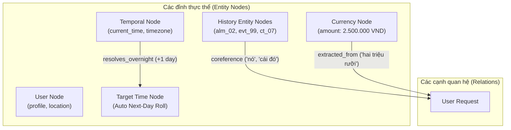
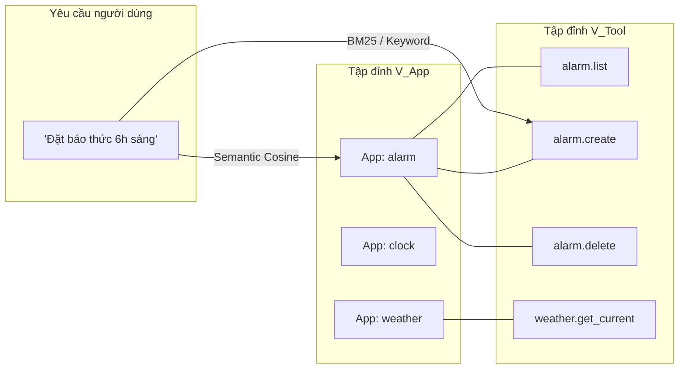
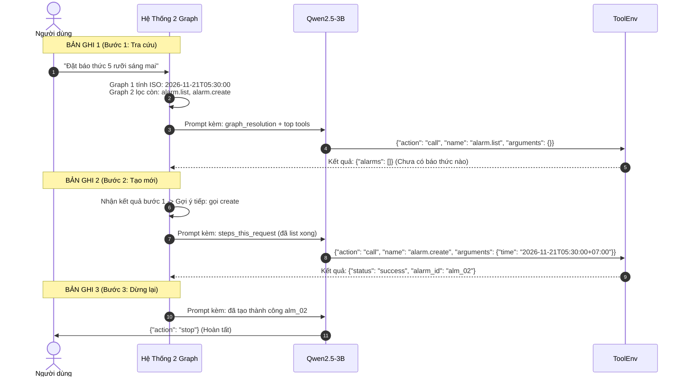

# CHUYÊN ĐỀ KIẾN TRÚC & CƠ CHẾ HOẠT ĐỘNG CỦA HỆ THỐNG 2 GRAPH
## LIFE MATE AGENT — ZALO AI CHALLENGE 2026

---

## 1. TẠI SAO PHẢI CÓ 2 GRAPH? (TRIẾT LÝ THIẾT KẾ)

Trong các bài toán Agentic AI, nếu chỉ dựa vào một mình LLM để đọc toàn bộ ngữ cảnh thì mô hình thường gặp 3 "căn bệnh" chết người:
1. **Bệnh quá tải công cụ (Tool Overload):** Có tới 36 app và 122 công cụ. Nhồi tất cả vào prompt khiến context phình to, model bị nhiễu, suy luận chậm và dễ bốc nhầm công cụ tương đồng.
2. **Bệnh ảo giác định danh (Entity Hallucination):** Người dùng nói *"xóa cái báo thức đó đi"*, LLM tự bịa ra ID như `"alarm_1"`, `"alarm_xyz"` trong khi cơ sở dữ liệu lưu là `"alm_02"`. Sai một ký tự là chấm 0 điểm.
3. **Bệnh mù thời gian (Temporal Blindness):** Giờ hiện tại là `16:10`, người dùng bảo *"hẹn giờ 5h30 sáng"*. LLM thường chọn nhầm ngày hôm nay lúc 05:30 (tức thời gian đã trôi qua trong quá khứ $\rightarrow$ lỗi ToolEnv).

👉 **Giải pháp:** Xây dựng **Hệ thống 2 Graph In-Memory (chạy bằng Python thuần túy, latency $\le 0.5\text{ms}$, 0 tham số)** để làm nhiệm vụ "dọn cỗ sẵn" cho LLM:
- **Graph 1 (Dialogue-Entity State Graph):** Giải quyết ngữ nghĩa, thời gian và thực thể lịch sử.
- **Graph 2 (Bipartite Tool Graph):** Giải quyết không gian công cụ, thu hẹp 122 tools về top 10 tools liên quan nhất.

---

## 2. GRAPH 1: DIALOGUE-ENTITY STATE GRAPH (ĐỒ THỊ THỰC THỂ & HỘI THOẠI)

### 2.1. Bản chất & Cấu trúc Đồ thị
Graph 1 được dựng động (on-the-fly) trong bộ nhớ RAM cho mỗi sample dựa trên 3 nguồn dữ liệu: `request`, `context` và `history`.



### 2.2. Ba Cơ chế tác động chính của Graph 1

#### Cơ chế 1: Auto Next-Day Roll (Cuộn ngày tự động)
- **Vấn đề:** Các câu lệnh hẹn giờ, đặt lịch thường nói giờ mà không nói ngày ("hẹn 6h sáng").
- **Thuật toán của Graph 1:**
  1. Trích xuất giờ mục tiêu $T_{\text{target}}$ từ câu nói (ví dụ `05:30`).
  2. Lấy giờ hiện tại $T_{\text{current}}$ từ `context.current_time` (ví dụ `2026-11-20T16:10:00+07:00`).
  3. So sánh: Nếu $T_{\text{target}} \le T_{\text{current}}$ $\rightarrow$ mục tiêu là **ngày mai** ($\text{Date} = \text{Date}_{\text{current}} + 1\text{ ngày}$).
  4. Xuất chuỗi ISO-8601 tuyệt đối: `2026-11-21T05:30:00+07:00`.
  5. Đưa vào prompt: Model chỉ việc copy chuỗi này vào argument `time`, đảm bảo 100% không bị lỗi thời gian quá khứ.

#### Cơ chế 2: Anaphora & History Entity Tracker (Truy vết đại từ chỉ định)
- **Vấn đề:** Người dùng nói *"tắt nó đi"*, *"gửi tin nhắn cho người đó"*.
- **Thuật toán của Graph 1:**
  1. Quét toàn bộ `history` (các lượt hội thoại trước) và bóc tách các entity ID đã xuất hiện trong `tool_calls` hoặc `tool_results`:
     - Báo thức: `alarm_id` (`"alm_01"`, `"alm_02"`)
     - Lịch trình: `event_id` (`"evt_101"`)
     - Danh bạ: `contact_id` (`"ct_007"`), `phone_number`
     - Thiết bị: `device_id` (`"dev_light_01"`)
  2. Khi phát hiện các từ thay thế ("nó", "cái đó", "báo thức vừa rồi"), Graph 1 tự động map với ID gần nhất trong lịch sử.
  3. Cung cấp sẵn trong prompt: `"active_entity_refs": {"alarm_id": "alm_02"}`.

#### Cơ chế 3: Workflow Chaining & Read-Before-Write (Ràng buộc chuỗi hành động)
- **Vấn đề:** Nhiều tác vụ đòi hỏi phải tra cứu trước khi tạo/sửa (ví dụ: muốn đặt lịch phải kiểm tra xem có bị trùng không; muốn sửa báo thức phải biết danh sách hiện có).
- **Thuật toán của Graph 1:**
  - Nhận diện các liên từ nối ("rồi", "sau đó", "tiếp theo", "đồng thời").
  - Phân loại công cụ thành 2 nhóm: `kind="read"` (tra cứu: list, search, get) và `kind="write"` (thao tác: create, update, delete).
  - Ra chỉ dẫn: Nếu chưa có ID thực thể, **bắt buộc gọi tool `read` ở bước 1, sau đó mới gọi tool `write` ở bước 2**.

---

## 3. GRAPH 2: BIPARTITE TOOL GRAPH (ĐỒ THỊ HAI PHÍA CÔNG CỤ & ỨNG DỤNG)

Nằm trong module [`src/lifemate/graph_retrieval.py`](file:///D:/ZALO-AI/ZALO_AI_CHALLENGE_2026/src/lifemate/graph_retrieval.py).

### 3.1. Cấu trúc Đồ thị Hai phía (Bipartite Graph)
Đồ thị gồm 2 tập đỉnh tách biệt:
- **Tập đỉnh $V_{\text{App}}$:** 36 ứng dụng (`alarm`, `calendar`, `contacts`, `notes`, `device_control`,...).
- **Tập đỉnh $V_{\text{Tool}}$:** 122 công cụ (`alarm.create`, `alarm.list`, `calendar.add_event`,...).
- **Tập cạnh $E$:** Cạnh có hướng nối từ $\text{App} \leftrightarrow \text{Tool}$ thể hiện quan hệ sở hữu và phụ thuộc tham số.



### 3.2. Thuật toán Xếp hạng lai wRRF (Weighted Reciprocal Rank Fusion)

Thay vì chỉ so khớp câu chữ đơn thuần, Graph 2 sử dụng thuật toán **wRRF** với 2 trọng số:
- $\alpha_A = 1.5$ (Trọng số của Ứng dụng - App Score).
- $\alpha_T = 1.0$ (Trọng số của Công cụ - Tool Score).

$$\text{RRF\_Score}(Tool) = \frac{\alpha_T}{k + \text{Rank}_T(Tool)} + \frac{\alpha_A}{k + \text{Rank}_A(\text{App of Tool})}$$

*(với $k = 10$ là hằng số làm mượt).*

#### Tại sao thuật toán này giải quyết được bài toán ZERO-SHOT trên 11 app mới?
1. Khi gặp một ứng dụng hoàn toàn mới ở tập Public Test (ví dụ app xe thông minh `smart_car` chưa từng có trong tập train):
2. Graph 2 không dựa vào việc model đã "học vẹt" tên tool hay chưa, mà phân tích **ngữ nghĩa của mô tả ứng dụng (App Description)** và **mô tả tham số (Schema Description)**.
3. Nếu người dùng bảo *"hạ kính xe ô tô xuống một nửa"*, Graph 2 lập tức kích hoạt đường truyền:
   $$\text{Query} \xrightarrow{\text{semantic}} \text{App: smart\_car} \xrightarrow{\text{edge}} \text{Tool: smart\_car.set\_window\_level}$$
4. Nhờ đó, công cụ mới toanh được đẩy ngay vào **Top 10 tools** gửi cho LLM. LLM chỉ cần nhìn schema là gọi được ngay!

---

## 4. TÁC ĐỘNG CỦA 2 GRAPH VÀO 3 BẢN GHI SFT VÀ VÒNG LẶP SUY LUẬN

Hàm [`build_messages()`](file:///D:/ZALO-AI/ZALO_AI_CHALLENGE_2026/src/lifemate/prompts.py) là **điểm hội tụ duy nhất** của cả hệ thống. Nó đảm bảo định dạng đầu vào lúc sinh dữ liệu huấn luyện (`prepare_sft.py`) và lúc chạy online (`runner.py`) **giống nhau 100% (Zero-Skew)**.

### Giả sử yêu cầu: *"Đặt báo thức 5 rưỡi sáng mai"* (Giờ hiện tại: 16:10 chiều)



---

## 5. MINH HỌA TRỰC QUAN: SO SÁNH TRƯỚC VÀ SAU KHI CÓ 2 GRAPH

### Khi CHƯA có 2 Graph:
```json
// Prompt gửi cho LLM:
{
  "request": "Xóa báo thức đó và đặt lại lúc 5 rưỡi sáng",
  "context": {"current_time": "2026-11-20T16:10:00+07:00"},
  "available_tools": [ ... 122 tools dài dằng dặc ... ],
  "history": [ ... ]
}
// HẬU QUẢ:
// 1. LLM quá tải với 122 tools -> bốc nhầm sang calendar hoặc clock.
// 2. LLM không biết "báo thức đó" là ID nào -> bịa ra "alarm_1" -> BỊ LỖI.
// 3. LLM tự tính giờ 5 rưỡi sáng thành "2026-11-20T05:30:00" (quá khứ) -> BỊ LỖI.
```

### Khi ĐÃ có 2 Graph:
```json
// Prompt gửi cho LLM:
{
  "request": "Xóa báo thức đó và đặt lại lúc 5 rưỡi sáng",
  "context": {"current_time": "2026-11-20T16:10:00+07:00"},
  "graph_resolution": {
    "resolved_temporal": {
      "alarm_time": "2026-11-21T05:30:00+07:00"  // <-- Graph 1 tính sẵn ngày mai
    },
    "active_entity_refs": {
      "alarm_id": "alm_02"                       // <-- Graph 1 nhặt sẵn ID từ history
    },
    "workflow_directive": "Bước 1: alarm.delete -> Bước 2: alarm.create"
  },
  "available_tools": [
    // <-- Graph 2 đã lọc CHỈ CÒN 3 tool liên quan nhất
    {"name": "alarm.delete", "parameters": {...}},
    {"name": "alarm.create", "parameters": {...}},
    {"name": "alarm.list", "parameters": {...}}
  ]
}
// KẾT QUẢ:
// LLM chỉ việc đọc "cỗ đã dọn sẵn" và nhả ra JSON chính xác 100%!
```

---

## 6. KẾT LUẬN & ĐỊNH HƯỚNG BẢO TRÌ

Hệ thống 2 Graph là **chìa khóa công nghệ khác biệt** của LifeMate so với các giải pháp thông thường:
- **Tốc độ:** $\le 0.5\text{ms}$ in-memory, hoàn toàn offline, không phụ thuộc database ngoài.
- **Tiết kiệm tài nguyên:** 0 tham số mô hình, giải phóng hơn 2 Tỷ tham số cho LLM và ASR.
- **Tính ổn định:** Biến các bài toán khó (tính ngày giờ, truy vết ID, lọc 122 tools) thành các phép toán xác thực (deterministic), giúp LLM chỉ tập trung làm đúng nhiệm vụ thế mạnh của nó: **sinh mã JSON chuẩn xác**.

