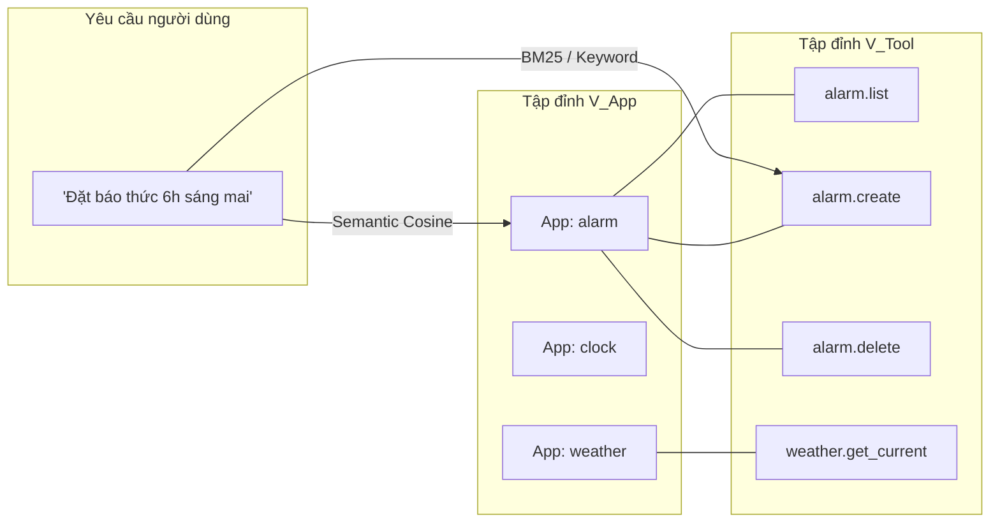
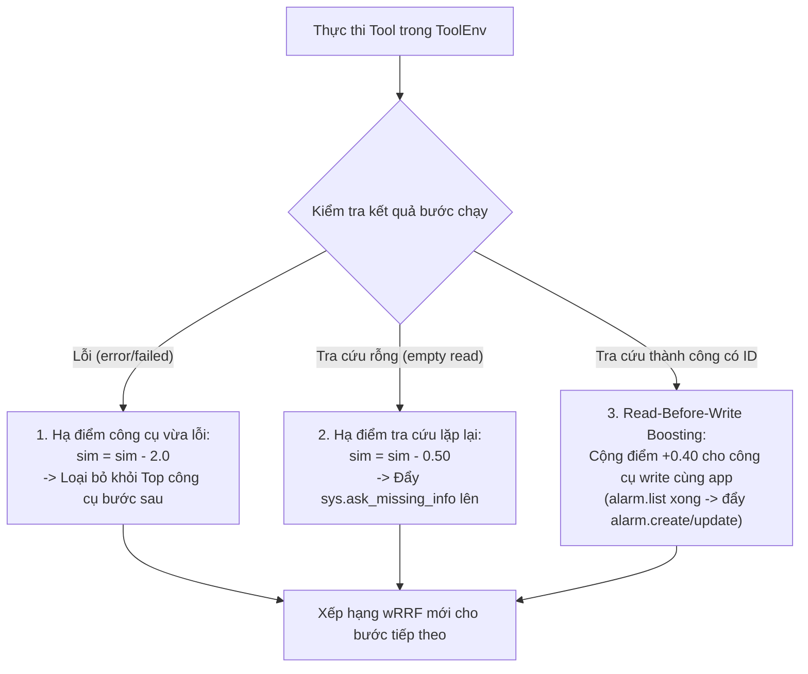

# CHUYÊN ĐỀ KIẾN TRÚC TOOLNET (BIPARTITE TOOL GRAPH) & THÍCH ỨNG ĐỘNG
## LIFE MATE AGENT — ZALO AI CHALLENGE 2026

---

## 1. TẠI SAO CẦN TOOLNET? (TRIẾT LÝ THIẾT KẾ)

Trong các bài toán Agentic AI có số lượng công cụ lớn (36 ứng dụng, 122 công cụ):
1. **Bệnh quá tải công cụ (Tool Overload):** Nhồi tất cả 122 tools vào prompt khiến context phình to, model bị nhiễu, suy luận chậm và dễ bốc nhầm công cụ tương đồng.
2. **Hiện tượng lặp lại lỗi (Error Looping):** Khi một công cụ gọi bị lỗi, nếu không có cơ chế thích ứng, LLM thường có xu hướng gọi lại y hệt công cụ đó ở lượt tiếp theo.
3. **Thách thức Zero-Shot trên 11 app mới:** Ban tổ chức đưa vào 11 ứng dụng hoàn toàn mới ở tập Public Test mà tập train không hề có.

👉 **Phân định vai trò trong hệ thống:**
- **Tầng Ngôn ngữ & Suy Luận Hội Thoại:** Được giao trọn vẹn cho **`DeepSeek-R1-Distill-Qwen-1.5B`** (sử dụng Native Chain-of-Thought `<think>` để tự suy luận ngày mai, tiền tệ, sửa lỗi ASR dựa vào `history`).
- **Tầng Công cụ (ToolNet - Bipartite Tool Graph):** Chuyên trách quản lý, lọc từ 122 tools xuống Top 10 tools, và tự động thích ứng dìm điểm công cụ lỗi.

---

## 2. CẤU TRÚC ĐỒ THỊ HAI PHÍA (BIPARTITE TOOL GRAPH)

Nằm trong module [`src/lifemate/graph_retrieval.py`](file:///D:/ZALO-AI/ZALO_AI_CHALLENGE_2026/src/lifemate/graph_retrieval.py).

### 2.1. Hai tập đỉnh tách biệt:
- **Tập đỉnh $V_{\text{App}}$:** 36 ứng dụng (`alarm`, `calendar`, `contacts`, `notes`, `device_control`,...).
- **Tập đỉnh $V_{\text{Tool}}$:** 122 công cụ (`alarm.create`, `alarm.list`, `calendar.add_event`,...).
- **Tập cạnh $E$:** Cạnh có hướng nối từ $\text{App} \leftrightarrow \text{Tool}$ thể hiện quan hệ sở hữu và phụ thuộc tham số.

---

## 3. THUẬT TOÁN XẾP HẠNG LAI wRRF & ĐỘT PHÁ ZERO-SHOT

Thuật toán **wRRF (Weighted Reciprocal Rank Fusion)** gán 2 trọng số:
- $\alpha_A = 1.5$ (Trọng số Ứng dụng - App Score).
- $\alpha_T = 1.0$ (Trọng số Công cụ - Tool Score).

$$\text{RRF\_Score}(Tool) = \frac{\alpha_T}{k + \text{Rank}_T(Tool)} + \frac{\alpha_A}{k + \text{Rank}_A(\text{App of Tool})}$$

*(với $k = 10$ là hằng số làm mượt).*

### Tại sao giải quyết được bài toán Zero-Shot trên 11 app mới?
1. Khi gặp ứng dụng mới toanh (ví dụ `smart_car` chưa từng có trong tập train):
2. ToolNet không dựa vào việc model đã "học vẹt" tên tool hay chưa, mà phân tích ngữ nghĩa mô tả ứng dụng (`App Description`) và mô tả tham số (`parameters`).
3. Tín hiệu ngữ nghĩa từ câu nói người dùng truyền sang `App: smart_car`, rồi lan truyền dọc theo cạnh đồ thị xuống các tools con:
   $$\text{Query} \xrightarrow{\text{semantic}} \text{App: smart\_car} \xrightarrow{\text{edge}} \text{Tool: smart\_car.set\_window\_level}$$
4. Nhờ đó, công cụ mới toanh được đẩy ngay vào **Top 10 tools** gửi cho LLM.

---

## 4. CƠ CHẾ THÍCH ỨNG ĐỘ THỊ TỪ DƯỚI LÊN (TOOLNET BOTTOM-UP ADAPTATION)

Khi kết hợp với **Reflexion**, đồ thị ToolNet cập nhật trọng số động theo kết quả thực thi của từng bước:

---

## 5. TỔNG KẾT: TỐC ĐỘ & HIỆU NĂNG

- **Latency:** $\le 0.5\text{ms}$ chạy hoàn toàn in-memory bằng Python thuần túy.
- **Tham số:** 0 tham số mô hình.
- **Độ tin cậy:** Không phụ thuộc database ngoài (Neo4j), chạy offline 100% trong Docker của Ban tổ chức.
